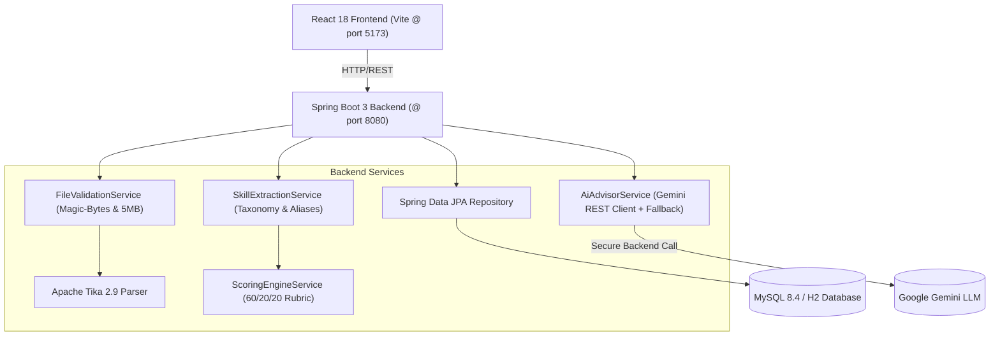

# AI Resume Analyzer & Match Engine 🚀
> **Full-Stack Portfolio Project for MCA Software Engineer (SDE) Placements (2027)**

An enterprise-grade, full-stack AI Resume Analyzer and Job Description Match Engine built with **Java 21, Spring Boot 3, Apache Tika, MySQL / Spring Data JPA, Google Gemini LLM API, and React 18 + Vite**.


---

## 🌟 Key Features

1. **Robust Resume Parsing**:
   - Parses text cleanly from **PDF**, **DOCX**, and **DOC** files using Apache Tika.
   - Enforces a 5 MB maximum file upload limit.
   - Inspects file magic bytes/signatures to block file extension spoofing (e.g., binaries renamed to `.pdf`).
   - Normalizes whitespace, cleans carriage returns, removes ASCII control characters, and calculates accurate word and character counts.

2. **Curated Software Engineering Skills Taxonomy**:
   - Curated dictionary of 67+ industry skills covering Languages, Frameworks, Databases, Cloud & DevOps, Core Architecture, and Soft Skills.
   - Boundary-safe regular expressions preventing false positives (e.g. `Java` will **never** false-match `JavaScript`).
   - Comprehensive alias resolution (e.g. `k8s` $\rightarrow$ `Kubernetes`, `reactjs` $\rightarrow$ `React`, `springboot` $\rightarrow$ `Spring Boot`, `postgres` $\rightarrow$ `PostgreSQL`).

3. **Transparent, Rule-Based Match Scoring Rubric**:
   - **No fake "guaranteed ATS" claims**—everything is 100% explainable and educational:
     - **Technical Skills Match (60 pts max)**: Exact ratio of matched job technical requirements.
     - **Soft Skills & Practices (20 pts max)**: Communication, collaboration, and methodological skills.
     - **Domain Keyword Overlap (20 pts max)**: Token relevance and domain density between resume and job description.
   - Outputs: Matched Skills, Missing Skills, and Bonus Candidate Strengths.

4. **Secure AI Career Advisor (Backend LLM)**:
   - Zero frontend API key leakage—API keys are strictly managed via server environment variables.
   - Dual-Mode Engine:
     - **Live Mode**: Calls Google Gemini API (`gemini-1.5-flash`) via Spring 6 `RestClient`.
     - **Automated Fallback**: Gracefully degrades to an intelligent rule-based engine if no API key is provided or during network timeouts.
   - Google **XYZ Formula** Bullet Rewrites (*"Accomplished [X], as measured by [Y], by doing [Z]"*).
   - Concrete **Project Bridging Strategies** for missing skills.

5. **Persistence & Historical Analysis (MySQL + JPA)**:
   - Stores analysis reports, matched/missing skills JSON, and AI advice in MySQL.
   - Built-in paginated history drawer with 1-click report reload and deletion.
   - Dual-profile configuration: MySQL for production, resilient H2 for zero-friction local demos and testing.

6. **Modern High-Performance Dashboard**:
   - Built with React 18 and a custom Vanilla CSS design system (deep obsidian theme, glassmorphism, animated circular SVG score dial, and responsive mobile-first grid).

---

## 🏛️ System Architecture



---

## 🚀 Getting Started

### Prerequisites
- **Java**: JDK 21 or higher (Tested with Java 21 / 25)
- **Node.js**: v18+ (Tested with Node v24.16.0 / npm 11.13.0)
- **Database**: MySQL 8.4 (or use built-in zero-config persistent storage)

---

### 1. Running the Backend (Spring Boot)

```bash
cd backend

# Run the complete test suite (31 unit & integration tests)
./mvnw clean test

# Start the Spring Boot server (Default: port 8080)
./mvnw spring-boot:run
```

*Optional Gemini API key*: Set `AI_API_KEY` in your environment or `application.properties`:
```bash
set AI_API_KEY=your_gemini_api_key
```
*(If omitted, the backend automatically uses the intelligent rule-based advisory engine!)*

---

### 2. Running the Frontend (React + Vite)

```bash
cd frontend

# Install dependencies
npm install

# Start the development server (Default: port 5173)
npm run dev
```

Open your browser at **`http://localhost:5173`**.

---

## 🧪 Test Coverage & Quality Assurance

The backend includes a comprehensive suite of **31 JUnit 5 and MockMvc integration tests**:

| Test Class | Coverage Area | Status |
| :--- | :--- | :--- |
| `FileValidationServiceTest` | Magic bytes detection, file spoofing, 5MB size limit, path traversal defense | Passed (5/5) |
| `ResumeParserServiceTest` | Apache Tika PDF parsing, whitespace normalization, word/char counts | Passed (3/3) |
| `SkillExtractionServiceTest` | Regex word boundaries (Java vs JavaScript), alias mapping (k8s $\rightarrow$ Kubernetes), C++/C# symbols | Passed (5/5) |
| `ScoringEngineServiceTest` | 60/20/20 rubric calculations, matched/missing skill classification | Passed (3/3) |
| `AiAdvisorServiceTest` | Gemini JSON response deserialization, rule-based fallback advisory generation | Passed (2/2) |
| `ResumeExtractionControllerTest`| MockMvc upload endpoint (`200 OK`, `415 Unsupported Media Type`) | Passed (2/2) |
| `ResumeAnalysisControllerTest` | MockMvc analysis endpoints (`/analyze-match`, `/ai-advice`, `/analyze-full`) | Passed (5/5) |
| `AnalysisHistoryServiceTest` | JPA persistence, pagination, and record serialization | Passed (3/3) |
| `AnalysisHistoryControllerTest`| MockMvc history endpoints (`GET /history`, `DELETE /history/{id}`) | Passed (3/3) |

Run all tests:
```bash
./mvnw test
```

---

## 📡 REST API Reference

| Method | Endpoint | Description |
| :--- | :--- | :--- |
| `POST` | `/api/v1/resumes/extract-text` | Uploads PDF/DOCX and extracts normalized plain text |
| `POST` | `/api/v1/resumes/analyze-match` | Analyzes JSON resume text against target job description |
| `POST` | `/api/v1/resumes/ai-advice` | Generates AI bullet rewrites and skill bridging tips |
| `POST` | `/api/v1/resumes/analyze-full` | Unified endpoint returning match scores, skills, and AI advice |
| `GET` | `/api/v1/resumes/history` | Retrieves paginated analysis history from database |
| `GET` | `/api/v1/resumes/history/{id}` | Retrieves full report details by record ID |
| `DELETE`| `/api/v1/resumes/history/{id}` | Deletes historical analysis session |

---

## 🎓 Targeted for MCA SDE Placements (2027)

This project is tailored to showcase industry-ready software engineering competencies:
- **Clean Architecture & Separation of Concerns** (Controllers, DTOs, Services, Repositories, Entities).
- **Security-First Mindset**: Magic byte validation against malicious uploads, path traversal defense, and zero frontend API secret leakage.
- **Enterprise Testing**: Unit testing with JUnit 5, Mockito, and web layer slice testing with MockMvc.
- **Scalable Data Modeling**: Relational persistence with Spring Data JPA and Hibernate.
- **Modern Frontend UX**: Component-driven React 18, SVG animations, glassmorphism design system, and responsive layout.
